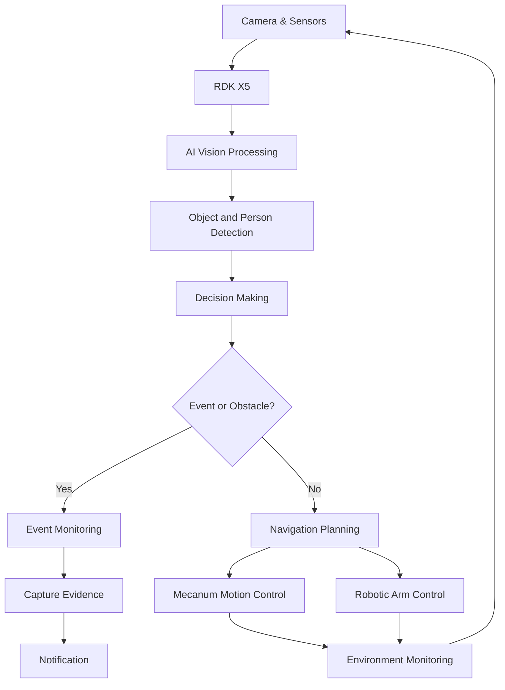

# GuardianBot
**AI-Powered Smart Home Assistant & Security Robot**

* **Project Name:** GuardianBot
* **Project Category:** Smart Life Robotics
* **Development Platform:** D-Robotics RDK X5
* **Robot Platform:** MasterPi AI Vision Robot Arm with Mecanum Wheels
* **Development Focus:** Edge AI, Computer Vision, Mobile Robotics, Robotic Manipulation
* **Competition:** Robotics Dream Keeper Challenge

---

## 1. Project Overview
**GuardianBot** is an intelligent home assistant and security robot developed using Artificial Intelligence (AI) and Robotics technologies to autonomously monitor, patrol, and inspect indoor home environments.

This project utilizes the **D-Robotics RDK X5** as the primary computing unit for AI workloads and the **MasterPi AI Vision Robot Arm with Mecanum Wheels** as the base robotic platform. GuardianBot uses onboard cameras and AI Vision to detect people, objects, and anomalies within designated areas. It can navigate to various inspection checkpoints, avoid obstacles, and use its robotic arm to pick up objects or adjust the camera angle to explore additional areas.

AI processing executes locally on the robot via the RDK X5, aiming to reduce reliance on cloud computing and support Edge AI operation.

### 1.1 Project Objectives
1. Develop a robot capable of inspecting indoor home environments using AI Vision.
2. Develop a person and object detection system using AI.
3. Develop an autonomous mobility system utilizing Mecanum Wheels.
4. Develop an obstacle detection and avoidance system.
5. Develop a robotic arm system capable of picking up and handling objects.
6. Develop a camera-angle adjustment system using the robotic arm to explore surroundings.
7. Develop an anomaly event monitoring and user alert system.
8. Utilize the RDK X5 for onboard Edge AI processing.

---

## 2. Robot Capabilities

### 2.1 AI Vision
GuardianBot uses its camera paired with AI models to analyze the surrounding environment.

**Planned Capabilities:**
* **Person Detection:** Detect people within the monitored area.
* **Object Detection:** Detect and classify objects.
* **Object Tracking:** Track the positions of objects.
* **Scene Analysis:** Analyze the surrounding environment.
* **Event Detection:** Detect predefined events.
* **Evidence Capture:** Capture image evidence when an event occurs.

**Example Use Cases:**
* Detecting the presence of a person in an area.
* Detecting objects blocking a pathway.
* Detecting displaced or moved items.
* Capturing images of events requiring inspection.

> **Note:** Person detection does not imply personal identification. Facial recognition or identity verification is an additional function that requires careful consideration regarding privacy and security.

### 2.2 Autonomous Patrol
GuardianBot can navigate to predefined inspection checkpoints.

**Planned Capabilities:**
* Define inspection checkpoints (Waypoints).
* Navigate along designated routes.
* Monitor the environment while traveling.
* Check for obstacles along the path.
* Halt when an unsafe situation is encountered.
* Report operational status.

> **Note:** The initial version focuses on Waypoint Patrol, while SLAM (Simultaneous Localization and Mapping) and autonomous map generation will be considered for future development phases.

### 2.3 Obstacle Avoidance
Uses a Distance Sensor and visual data from the camera to inspect areas in front of or around the robot.

**Operating Principle:**
1. Measure distance from obstacles.
2. Evaluate whether an obstacle is obstructing the path.
3. Transmit data to the control system.
4. The robot decelerates, stops, or changes direction.
5. Re-verify the path before resuming movement.

### 2.4 Robotic Arm
GuardianBot utilizes the MasterPi robotic arm featuring a 5 Degrees of Freedom (5-DOF) structure. The robotic arm serves two primary functions:

**A. Object Manipulation**
* Pick up and handle objects.
* Relocate authorized objects.
* Inspect objects via the camera.
* Collaborate with AI Vision to estimate object positions.

**B. Camera Adjustment**
* Adjust camera viewing angles.
* Tilt the camera up and down (pitch).
* Rotate the camera to scan the area (pan/yaw).
* Adjust viewpoints to capture additional visual evidence.

> **Safety Constraint:** Object manipulation must undergo weight, size, and safety evaluation before physical actuation is executed.

### 2.5 Smart Event Monitoring
When AI detects an event matching predefined conditions, the system executes the following sequence:
1. Capture image frame from the camera.
2. Process the image using AI.
3. Classify the event type.
4. Record the image and timestamp.
5. Log data into the system.
6. Alert the user via the Dashboard.

### 2.6 Dashboard & Notification
Planned system features:
* Live Camera View
* Robot Status
* Patrol Status
* Event History
* Captured Images
* Battery Status
* Notification System

---

## 3. Working Principle
GuardianBot operates sequentially from data acquisition, processing, and decision-making to motion control.

### 3.1 Overall Working Process
1. **Sensing:** Acquire data from the camera and sensors.
2. **Perception:** Analyze images and detect objects using AI.
3. **Decision Making:** Evaluate the situation and select an appropriate response.
4. **Motion Planning:** Plan movement trajectories.
5. **Actuation:** Drive motors and robotic arm servos.
6. **Monitoring:** Verify outcomes and log events.

### 3.2 System Flow


### 3.3 Example Working Scenario
**Example:** GuardianBot detects an anomalous object indoors.
1. The robot navigates to an inspection waypoint.
2. The camera captures images of the environment.
3. The RDK X5 processes the image feed using AI.
4. The system detects an object requiring inspection.
5. The system evaluates position and safety conditions.
6. The robotic arm adjusts the camera angle to capture additional images.
7. The system logs the event image and timestamp.
8. The Dashboard displays the alert and information to the user.

> Physical object pickup occurs only when explicitly authorized and after passing all safety checks.

---

## 4. Hardware Architecture

### 4.1 Main Computing Unit — D-Robotics RDK X5
The RDK X5 serves as the primary computing unit of GuardianBot.

**Responsibilities:**
* Execute AI Vision processing
* Perform person and object detection
* Analyze camera video streams
* Process sensor data
* Process control commands
* Interface with the software stack
* Communicate with the robot controller

**Key Highlight:** Equipped with a dedicated BPU (Brain Processing Unit) for AI acceleration, enabling real-time Edge AI directly on the robot.

### 4.2 Robot Platform — MasterPi
MasterPi serves as the mechanical base for mobility and object manipulation.

**Components:**
* 4x Mecanum Wheels
* 4x TT Motors
* 5-DOF Robotic Arm
* HD Camera
* Ultrasonic Sensor
* Expansion Board
* Battery System

### 4.3 Hardware Integration Concept
Planned hardware interconnection concept:

```text
             GuardianBot
                  |
        +---------+---------+
        |                   |
      RDK X5             MasterPi
        |                   |
    AI Processing       Robot Control
        |                   |
   +----+----+          +---+------+
   |         |          |          |
 Camera   AI Model    Motors    Servo
   |                    |          |
   +------ Communication --------+
                  |
          Robot Operations
```

> **Important:** Compatibility between the Expansion Board (originally designed for Raspberry Pi 5) and the RDK X5—including GPIO, UART, I2C, PWM, Voltage levels, and Drivers—must be thoroughly verified before actual hardware integration. Do not assume direct plug-and-play compatibility.

---

## 5. MasterPi Hardware Inventory

### 5.1 Existing Hardware
The project currently has two primary hardware sets available: **RDK X5** and **MasterPi**.

**A. MasterPi AI Vision Robot Arm with Mecanum Wheels**

| No. | Component | Quantity | Function |
| :--- | :--- | :---: | :--- |
| 1 | MasterPi Robotic Arm (Pre-assembled) | 1 | Pick up objects and adjust camera angles |
| 2 | Chassis Brackets | 2 | Mount and support the robot frame |
| 3 | Expansion Board for Raspberry Pi 5 | 1 | Connect and control peripherals |
| 4 | Battery Box | 1 | House the batteries |
| 5 | Structural Blocks ($3 \times 3$ cm) | 3 | Structural assembly components |
| 6 | Mecanum Wheels | 4 | Enable omnidirectional movement |
| 7 | White Wheel Couplings | 4 | Connect motors to wheels |
| 8 | TT Motors | 4 | Drive the wheels |
| 9 | Lithium Batteries | 2 | Power supply |
| 10 | USB Cable | 1 | Connect devices |
| 11 | Battery Charger | 1 | Charge the batteries |
| 12 | Phillips Screwdriver | 1 | Assembly and maintenance |
| 13 | Nuts and Screws Set | 1 set | Fasten components |
| 14 | MicroSD Card Reader | 1 | Read and manage MicroSD cards |

**B. D-Robotics RDK X5**

| Component | Quantity | Function |
| :--- | :---: | :--- |
| RDK X5 | 1 | AI processing and main system control |

> **Note:** The availability of a MicroSD Card, cooling system, and an appropriate power supply must be verified separately, as they are not confirmed in the provided inventory list.

---

## 6. Additional Hardware Requirements
This list covers potential supplementary components that may need to be procured and are not confirmed as currently on hand.

| Component | Purpose | Necessity |
| :--- | :--- | :--- |
| MicroSD Card | Operating system and data storage | Needs verification |
| Power Supply 5V/5A for RDK X5 | Power the main compute board | Requires appropriate power source |
| Motor Controller | Control drive motors | Check existing board first |
| Servo Controller | Control robotic arm servos | Check existing board first |
| Wheel Encoder | Measure wheel rotation and odometry | Recommended |
| IMU Sensor | Measure motion, orientation, and heading | Recommended |
| Additional Distance Sensor | Detect surrounding obstacles | Based on test results |
| Emergency Stop | Immediately halt the system in emergencies | Highly recommended |
| DC-DC Converter | Step-down/regulate voltage levels | Based on power design |
| Cooling Fan / Heatsink | Thermal dissipation | Check existing accessories first |

> **Note:** Before purchasing additional hardware, existing circuitry and control board capabilities must be inspected to avoid redundant procurement.

---

## 7. Software Architecture

### 7.1 Main Software

| Software / Framework | Role / Function |
| :--- | :--- |
| Python | Primary development language |
| Linux | Operating system |
| AI Model | Object and person detection/classification |
| OpenCV | Image processing |
| RDK AI SDK | Leverage hardware AI/BPU capabilities of RDK X5 |
| ROS 2 | Robotics communication and system orchestration |
| Git / GitHub | Source code management |
| Dashboard | Status visualization and event monitoring |

> **Note:** Compatible versions of Linux, ROS 2, and SDK supported by the RDK X5 must be verified prior to installation.

### 7.2 Software Modules

```text
GuardianBot/
│
├── perception/
│   ├── camera.py
│   ├── person_detection.py
│   ├── object_detection.py
│   └── object_tracking.py
│
├── navigation/
│   ├── waypoint.py
│   ├── mecanum_control.py
│   └── obstacle_avoidance.py
│
├── manipulation/
│   ├── arm_control.py
│   ├── servo_control.py
│   └── object_pickup.py
│
├── monitoring/
│   ├── event_detection.py
│   ├── evidence_capture.py
│   └── notification.py
│
├── dashboard/
│
├── config/
│
└── main.py
```

---

## 8. Stage 2: Build — Development Plan
**Planned Execution Window:** November 11–26, 2026

* **Step 1: Project Definition**
  * Summarize Project Overview
  * Define Problem Statement
  * Define Objectives
  * Define Robot Capabilities
  * Define Success Criteria
* **Step 2: Hardware Analysis**
  * Inspect RDK X5
  * Inspect MasterPi
  * Inspect Expansion Board
  * Inspect Motor Driver
  * Inspect Servo Driver
  * Inspect Camera
  * Inspect Ultrasonic Sensor
  * Design Power Distribution
  * Compile BOM (Bill of Materials)
* **Step 3: System Architecture**
  * Draw System Architecture Diagram
  * Draw System Flow Diagram
  * Design Data Flow
  * Design Modules
  * Define BPU / CPU Compute Allocation
  * Design ROS 2 Node Graph
* **Step 4: Engineering Design**
  * Design Mecanum Motion Control
  * Design Obstacle Avoidance
  * Design Camera Adjustment
  * Design Object Manipulation
  * Design Event Monitoring
  * Design Emergency Stop
* **Step 5: Software Planning**
  * Define Software Architecture
  * Define Python Modules
  * Select AI Model
  * Plan Dashboard
  * Plan Data Storage
* **Step 6: Testing Plan**
  * Plan AI Vision Testing
  * Plan Motor Control Testing
  * Plan Robotic Arm Testing
  * Plan Obstacle Avoidance Testing
  * Plan Power System Testing
  * Plan System Integration Testing
* **Step 7: Documentation & Submission**
  * Prepare Project Documentation
  * Prepare Hardware Diagrams
  * Prepare Software Diagrams
  * Set up GitHub Repository
  * Verify Stage 2 Requirements
  * Prepare Project Showcase
  * Prepare Pull Request according to competition guidelines

---

## 9. Risk Analysis

| Risk | Impact | Mitigation Strategy |
| :--- | :--- | :--- |
| Expansion Board incompatible with RDK X5 | Unable to interface with hardware | Verify Pin Mapping and hardware interfaces |
| Insufficient power supply | System reboots or unstable operation | Design isolated power distribution circuits |
| Inaccurate motor control | Navigation and movement errors | Inspect Motor Driver and add Wheel Encoders |
| AI false detections | False alarms triggered | Fine-tune AI Model and Confidence Threshold |
| Robotic arm overload | Servo damage | Enforce payload weight limits and workspace boundaries |
| Robot collides with obstacles | Hardware damage | Implement multi-sensor detection and Emergency Stop |
| Overheating (High thermal load) | Degraded compute performance | Verify and install active cooling/heatsink system |

---

## 10. Expected Outcomes
Upon successful development of GuardianBot, the robot is expected to achieve the following:
1. Detect people and objects using AI Vision.
2. Analyze indoor home environments.
3. Navigate autonomously to designated inspection waypoints.
4. Detect and avoid obstacles.
5. Use the robotic arm to adjust camera angles.
6. Use the robotic arm to pick up authorized objects.
7. Capture and log event images and timestamps.
8. Send alerts and notifications to users.
9. Execute AI inference locally on the RDK X5.

> **Disclaimer:** All listed capabilities represent development goals and are not yet verified test results.

---

## 11. Stage 2 Completion Checklist

| Category | Status |
| :--- | :--- |
| Project Concept | Not Started |
| Hardware Analysis | Not Started |
| Hardware Architecture | Not Started |
| System Architecture | Not Started |
| AI Architecture | Not Started |
| ROS 2 Design | Not Started |
| Engineering Plan | Not Started |
| BOM | Not Started |
| Risk Analysis | Not Started |
| Testing Plan | Not Started |
| GitHub Documentation | Not Started |
| Project Submission | Not Started |

---

## 12. Project Development Direction
GuardianBot aims to integrate three core technological pillars:
1. **Edge AI:** Utilize the RDK X5 and its BPU for on-device image processing and environmental analysis.
2. **Mobile Robotics:** Utilize the MasterPi platform and Mecanum Wheels for omnidirectional indoor navigation.
3. **Robotic Manipulation:** Utilize the 5-DOF robotic arm for object handling and active camera-angle adjustment.

The ultimate goal is to develop an intelligent robot capable of perceiving, analyzing, deciding, navigating, and operating safely within a home environment.

---

* **Project Name:** GuardianBot
* **Platform:** D-Robotics RDK X5
* **Robot Base:** MasterPi AI Vision Robot Arm with Mecanum Wheels
* **Project Category:** Smart Life Robotics
* **Development Stage:** Stage 2 — Build

> *This document serves as the Project Design & Development Plan for GuardianBot, clearly distinguishing existing hardware on hand from proposed supplementary components, as well as separating planned development capabilities from verified test results.*