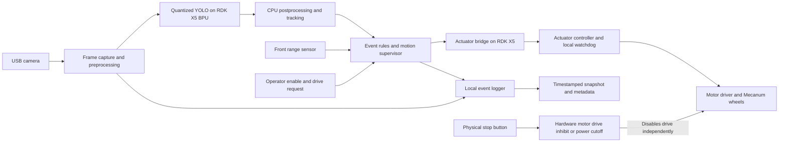
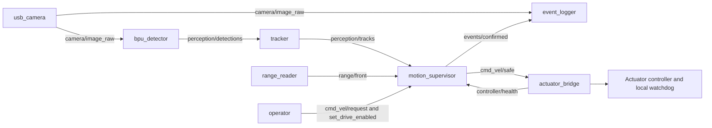

# GuardianBot — AI System Architecture

Stage 2 design for a supervised indoor demo on a flat floor. The planned baseline is onboard person/object detection and tracking, local event recording, and supervised low-speed Mecanum motion with a front stop interlock. Verify the range sensor, actuator controller, and power before enabling motion. All rates and thresholds below are initial design targets.

## Data flow

Autonomous waypoint patrol is an optional extension after validating supervised movement, safe stopping, and position estimation. Optional camera tilt is a separate, supervised extension after servo limits are verified. The front sensor protects forward approach only. Demo movement near obstacles is forward only, with lateral and reverse movement tested separately in a cleared area under supervision.

## Modules and failure behavior

| Module | Responsibility and input | Output | Failure behavior |
|---|---|---|---|
| Camera | Capture and timestamp USB/V4L2 frames | Local images | Report missing frames. Stale perception blocks motion. |
| Detector | Preprocess newest image, run BPU inference, decode detections | Timestamped boxes and class scores | Drop stale frames. Report model/runtime faults and inhibit motion when inference becomes stale. |
| Tracker | Associate boxes across frames on the CPU while inference continues on BPU | Tracks with stable IDs per run | Expire stale tracks. Suppress event confirmation when the input becomes stale. |
| Range input | Read the front sensor through the verified controller interface | Timestamped range in meters | Invalid or stale data blocks forward motion. |
| Supervisor | Apply enable, freshness, range and operator inputs. Confirm configured events. | Safe velocity and event records | Default to disarmed. Stop on a fault and require operator re-enable after recovery. |
| Actuator bridge | Convert safe velocities to bounded wheel commands and relay to controller | Wheel commands and controller health | Local controller watchdog stops the wheels if upstream commands stop. Startup is stopped until enabled. |
| Event logger | Match confirmed events to a small local frame buffer | Snapshot, timestamp, class and metadata | Report missing frames or storage failures. The motion supervisor and controller continue to enforce the stop path. |

## Compute allocation

- **BPU on RDK X5** runs quantized YOLO inference. Start with the official YOLO example and select the model artifact and runtime that match the installed RDK image. Record the actual model input shape separately from USB capture resolution.
- **CPU on RDK X5** handles capture, preprocessing, decoding, tracking, ROS 2, event decisions, local storage, and motor command supervision. Detection and tracking run in separate ROS 2 nodes. Bound queues so delayed frames cannot accumulate.
- **Actuator controller** runs motor I/O, the stop watchdog, and sensor acquisition as appropriate. This keeps the stop behavior available when the host or link fails. The physical stop independently inhibits motor drive.
- **Off-board** no cloud compute or operator laptop is required to enforce a stop. An operator laptop can send commands or view status locally. A separate Pi controller is an option if required by the MasterPi board.

## ROS 2 node graph

| Interface | Publisher → subscriber or provider | ROS 2 type | Target rate |
|---|---|---|---|
| /camera/image_raw | usb_camera → bpu_detector, event_logger | sensor_msgs/msg/Image | Camera up to 30 Hz at 640 × 480 |
| /perception/detections | bpu_detector → tracker | vision_msgs/msg/Detection2DArray | One per processed frame, goal 25 Hz |
| /perception/tracks | tracker → motion_supervisor | vision_msgs/msg/Detection2DArray | One per processed detection array, including empty arrays |
| /range/front | range_reader → motion_supervisor | sensor_msgs/msg/Range | Initial 10 Hz target, verify hardware |
| /cmd_vel/request | operator → motion_supervisor | geometry_msgs/msg/TwistStamped | 20 Hz while driving |
| /cmd_vel/safe | motion_supervisor → actuator_bridge | geometry_msgs/msg/TwistStamped | 20 Hz, including zero when disarmed |
| /controller/health | actuator_bridge → motion_supervisor | diagnostic_msgs/msg/DiagnosticArray | 5 Hz plus fault changes |
| /events/confirmed | motion_supervisor → event_logger | guardianbot_interfaces/msg/Event | On confirmation |
| /set_drive_enabled | motion_supervisor provides to operator | std_srvs/srv/SetBool | On request |

Event is a proposed custom interface carrying UTC event time, source frame timestamp, event ID, class ID, track ID and confidence. Use the frame timestamp to select the snapshot. Keep timestamps through vision processing. Measure timeouts on the actual link before moving. Start by evaluating 250 ms for stale requested/safe velocity, 300 ms for range freshness, and 500 ms for vision/health freshness. Tune the sensor stop threshold separately from the 20 cm final clearance target using measured braking distance and sensor offset. Test physical stop, command loss, invalid range, and re-enable with wheels off the ground before floor tests.

- [D-Robotics RDK Model Zoo](https://github.com/D-Robotics/rdk_model_zoo)
- [ROS 2 common interfaces](https://github.com/ros2/common_interfaces)
- [ROS vision interfaces](https://github.com/ros-perception/vision_msgs)
